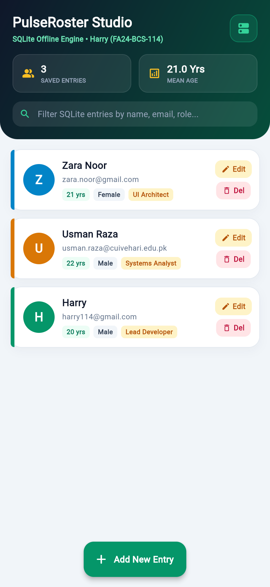
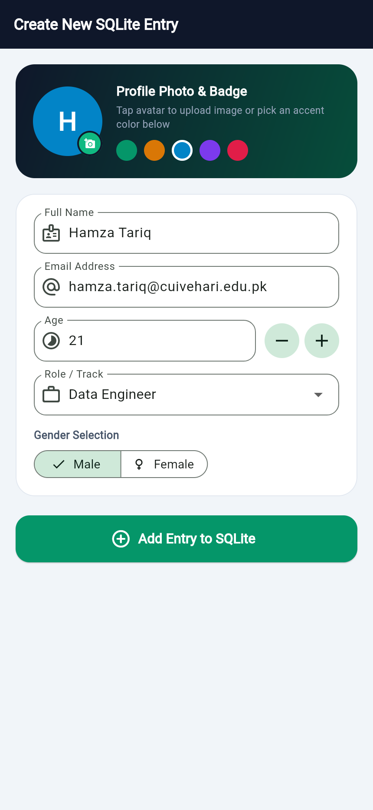
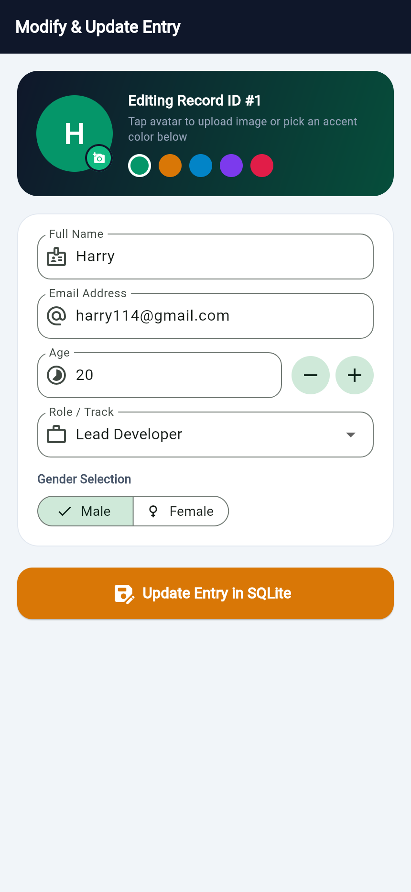
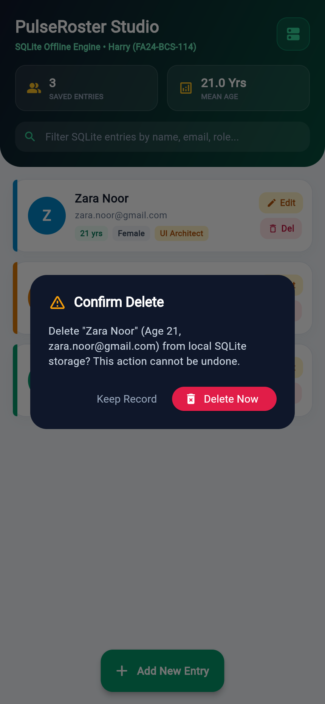

# Lab Assignment 1: PulseRoster Studio — SQLite CRUD (FA24-BCS-114)

**Submitted by:** Harry (FA24-BCS-114, Section B)

Offline Flutter CRUD application powered by sqflite supporting Add, View, Edit/Update, and Delete operations for member profiles (photo, name, email, age, role, and gender).

## CRUD Operation Screenshots

  
  &nbsp;
  

  
  &nbsp;
  

