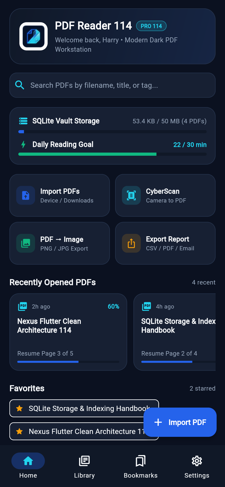
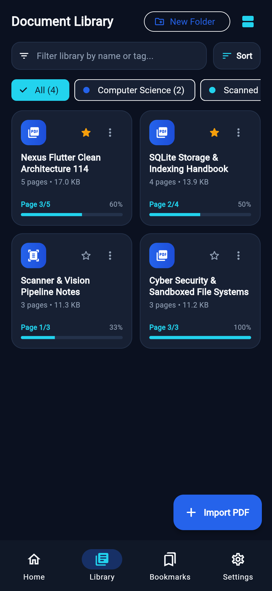
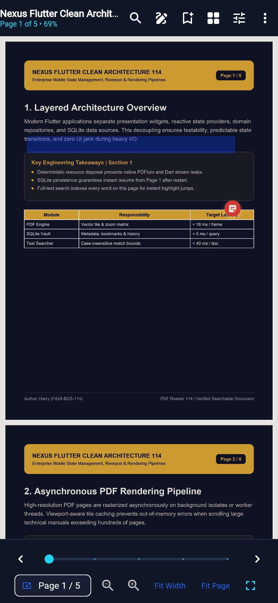
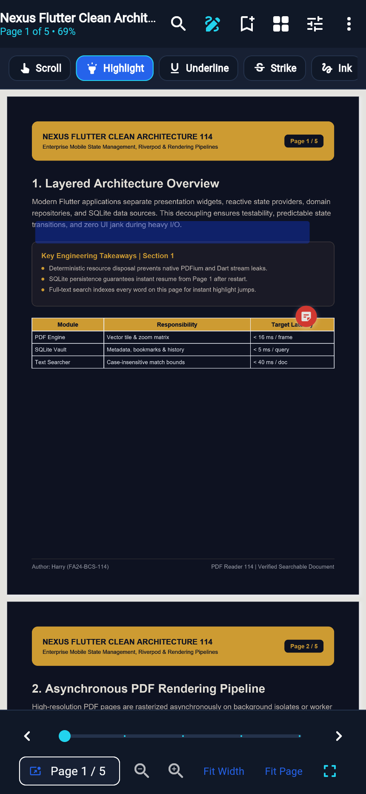
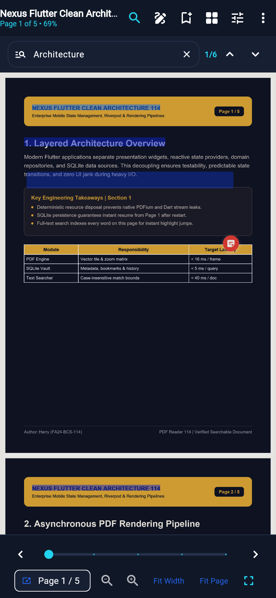
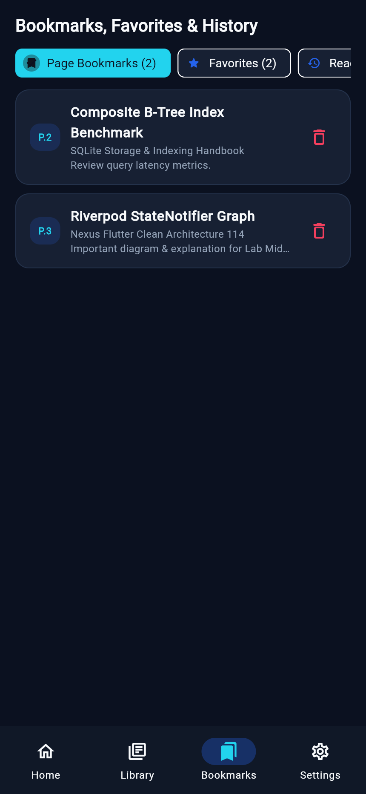
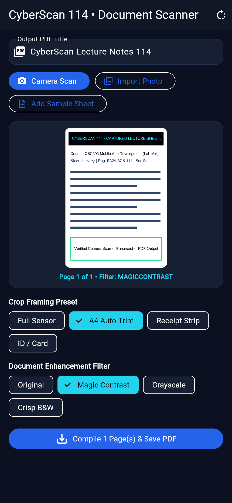
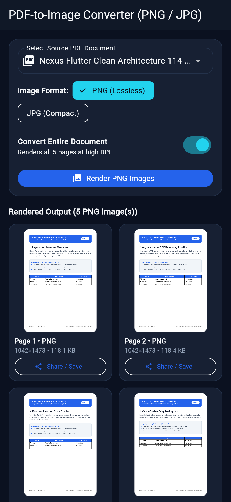
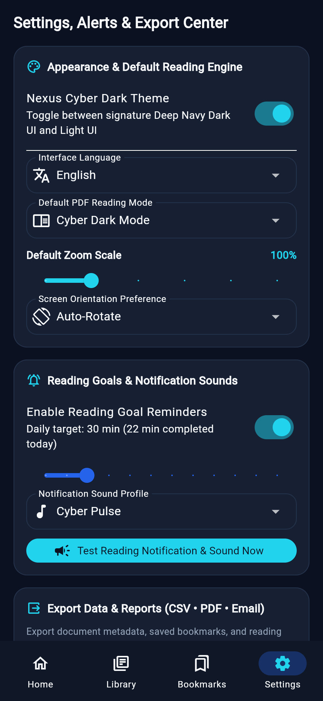

# PDF Reader 114 — Nexus Dark PDF Vault & Document Suite

**Student:** Harry (`FA24-BCS-114`, Section B)  
**Course:** CSC303 — Mobile Application Development (Lab Mid-Term Project)  
**Instructor:** Muhammad Abrar Saddique  
**Package ID:** `com.harry114.pdf_reader_114`  
**State Management:** Flutter Riverpod (`flutter_riverpod`)  
**Persistence Engine:** Relational SQLite (`sqflite` + `sqflite_common_ffi` unit-test engine + Web JSON fallback)

---

## Visual Identity & Design System

**PDF Reader 114** is engineered around a **Modern Cyber-Tech Dark Minimalist** design language tailored for focused technical reading, code/research paper review, and night-time study sessions:

| Token | Hex | Role |
| :--- | :--- | :--- |
| **Primary Surface** | `#101827` | Deep Navy command header, navigation bar, and modal chrome |
| **Secondary Accent** | `#2563EB` | Electric Royal Blue primary CTA buttons, active tabs, and selection borders |
| **Cyber Highlight** | `#22D3EE` | Neon Cyan progress meters, badge indicators, and active annotation tools |
| **Scaffold Canvas** | `#0B1120` | Ultra-dark obsidian workspace background |
| **Card Surface** | `#172033` | Elevated slate cards with subtle `#24324B` hairline borders |
| **Typography** | `#F8FAFC` / `#94A3B8` | Crisp white headings paired with soft slate-grey metadata |

---

## Live Application Screenshots

| Home Command Dashboard | Library & Folder Grid | Dark PDF Reader Workspace |
| :---: | :---: | :---: |
|  |  |  |

| Non-Destructive Annotation Studio | In-PDF Text Search & Match Navigation | Bookmarks & Reading History |
| :---: | :---: | :---: |
|  |  |  |

| CyberScan Camera-to-PDF Utility | PDF-to-Image (PNG/JPG) Converter | Settings, Chimes & CSV/PDF Export |
| :---: | :---: | :---: |
|  |  |  |

---

## Complete Feature Matrix

### 1. PDF Import & File Management
- Native single and multi-file `.pdf` import via `file_picker` (`FilePicker.pickFiles(allowMultiple: true)`), including Downloads & local storage browsing.
- Corrupted/empty PDF header verification (`%PDF-`) with clear error SnackBars and graceful missing-file recovery.
- Pre-seeded with **4 multi-page searchable academic PDFs** generated natively via `syncfusion_flutter_pdf` on first launch so every feature is immediately testable.
- Full CRUD lifecycle: **Rename & Edit Metadata/Tags**, **Duplicate Copy**, **Move between Custom Folders**, **Toggle Favorite**, **Delete with Confirmation Dialog**, **Document Technical Info Sheet**, and **Native Share** (`share_plus`).
- **Grid & List View** switcher, **4 Sort Modes** (`Recently Opened`, `Name`, `Date Modified`, `File Size`), and instant filename/tag search.

### 2. Advanced PDF Viewing & In-Document Search
- High-DPI multi-page rendering powered by `pdfrx` (`PdfViewer.data`) with smooth vertical continuous scrolling and horizontal spread layout toggle.
- Pinch-to-zoom, Zoom In / Out controls, **Fit-to-Width**, **Fit-to-Page**, **Full-Screen Immersive Mode**, **Page Thumbnails Drawer** (`PdfPageView`), **Interactive Page Slider**, **Jump-to-Page Dialog**, and **Previous / Next Page** controls.
- Automatically remembers and resumes from the exact last-read page stored in SQLite (`last_page`), while logging reading session duration.
- **In-PDF Text Search** (`PdfTextSearcher`) with live match highlighting, result counter, Previous/Next match stepping, and automatic scanned/no-OCR PDF detection banner.

### 3. Non-Destructive PDF Annotations & Flattened Export
- **Highlight**, **Underline**, **Strike-through**, **Freehand Vector Pen**, **Sticky Notes / Comments**, **5 Neon & Classic Color Swatches**, and **Tap-to-Erase**.
- **Save Annotated Copy**: Flattens vector strokes and callout notes onto a new `.pdf` copy using `syncfusion_flutter_pdf` while keeping the original document 100% untouched.

### 4. Companion Utilities (CSC303 Lab-Mid Rubric)
- **CyberScan Document Scanner**: Capture pages from Camera/Gallery (`image_picker`) or load built-in sample lecture notes, apply **4 Crop Presets**, **4 Image Enhancement Filters** (`Original`, `Auto Contrast`, `Crisp B&W`, `Grayscale` via `image`), rotate 90°, reorder pages, and compile into a multi-page `.pdf` indexed directly in SQLite.
- **PDF → Image Studio**: Rasterize any page or entire PDF into high-resolution **PNG** or **JPG** images (`page.render` + `image`), inspect pixel dimensions/sizes, and share/export individual frames.
- **CSV, PDF & Email Export Suite**: Export complete document catalog, bookmarks, and reading telemetry as a `.csv` spreadsheet, a formatted `.pdf` executive summary report, or pre-filled `mailto:` email dispatch.
- **Custom Chimes & Reading Goal Alerts**: Configurable daily reading target, reminder toggle, and selectable notification chimes (`Cyber Pulse`, `Sonar Ping`, `Soft Click`, `Silent`) with live sound/haptic preview.

---

## Clean Architecture & SQLite Schema

```text
lib/
├── constants/      # Palette hex constants, chime presets, default folders
├── models/         # Immutable data models (PdfDocModel, BookmarkItem114, PdfAnnotation114, etc.)
├── providers/      # Riverpod StateNotifiers (VaultLibraryNotifier, NexusPrefsNotifier)
├── repositories/   # DocumentRepository mediating SQLite + PDF engine operations
├── screens/        # 8 modular screens (Home, Library, Reader, Bookmarks, CyberScan, Converter, Settings)
├── services/       # VaultSqliteService (6 SQLite tables), PdfEngineService, ExportShareService
├── theme/          # Material 3 Dark Cyber-Tech ThemeData
├── utils/          # Formatters & conditional IO/Web byte loaders
└── widgets/        # NexusDocCard, AnnotationCanvasOverlay, DocDialogs114
```

**Relational SQLite Database (`nexus_vault_114.db` — 6 Tables):**
1. `vault_documents` — Metadata, file path, byte size, page count, folder FK, favorite flag, last read page, tags.
2. `vault_folders` — Custom user folders with accent color and creation timestamp.
3. `vault_bookmarks` — Page-level bookmarks linked via `doc_id` (`ON DELETE CASCADE`).
4. `vault_annotations` — Serialized stroke coordinates, tool type, color hex, and sticky-note text per page.
5. `vault_history` — Timestamped reading sessions and duration metrics.
6. `vault_preferences` — Persisted theme, zoom, reading mode, chime selection, language, and daily goal.

---

## Setup, Testing & Build Instructions

### Prerequisites
- Flutter SDK `>=3.24.0` (Dart `>=3.5.0`)
- Android Studio / Android SDK (for APK builds) or Chrome (for Web builds)

### Run & Verify
```bash
flutter pub get
flutter analyze
flutter test
flutter run
```

### Build Release APK (Android)
```bash
flutter build apk --release
```
*(Output APK: `build/app/outputs/flutter-apk/app-release.apk`)*
