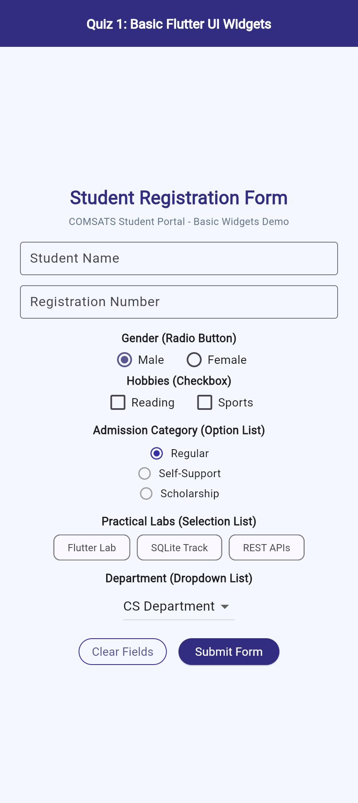
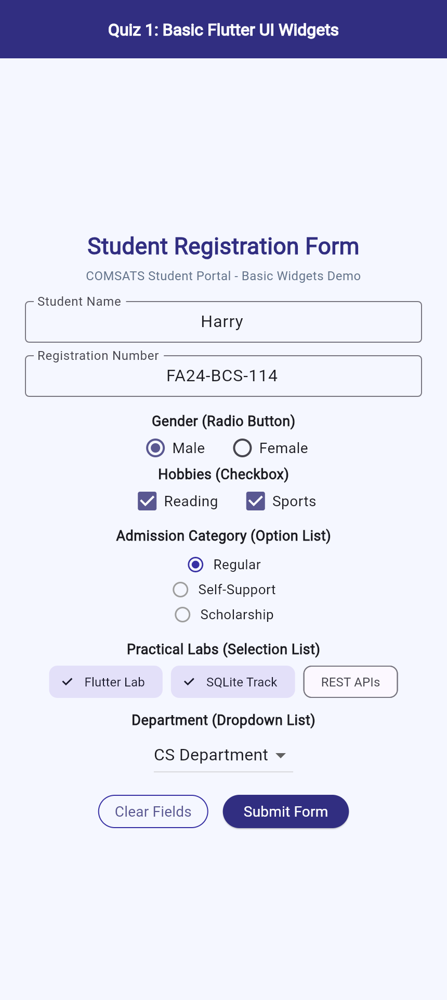
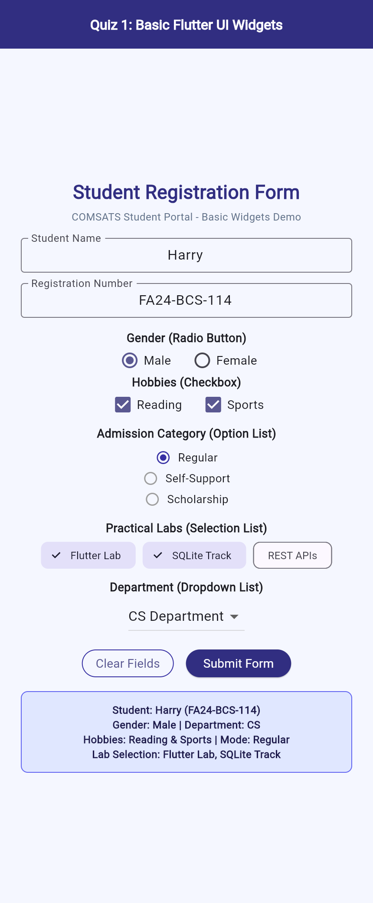

# Quiz 1: Basic Flutter UI Widgets (FA24-BCS-114)

**Submitted by:** Harry (FA24-BCS-114, Section B)

Demonstrates basic Flutter input, selection, and display widgets (Text, TextField, Radio, Checkbox, Option List, Selection List, DropdownButton, Clear Button, and Submit Button) aligned vertically in a centered Column.

## Application Output Screenshots

  
  &nbsp;
  
  &nbsp;
  

