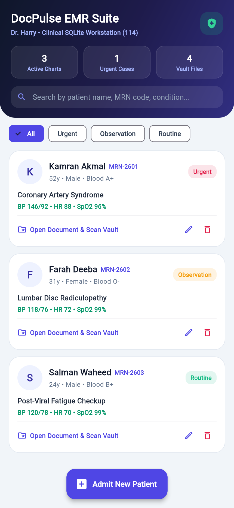
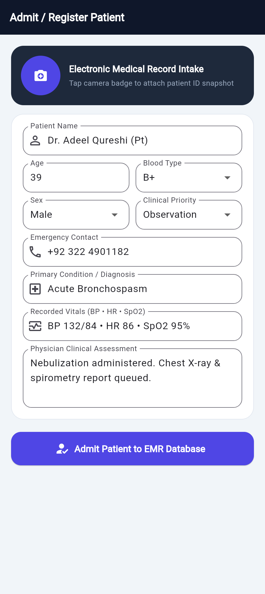
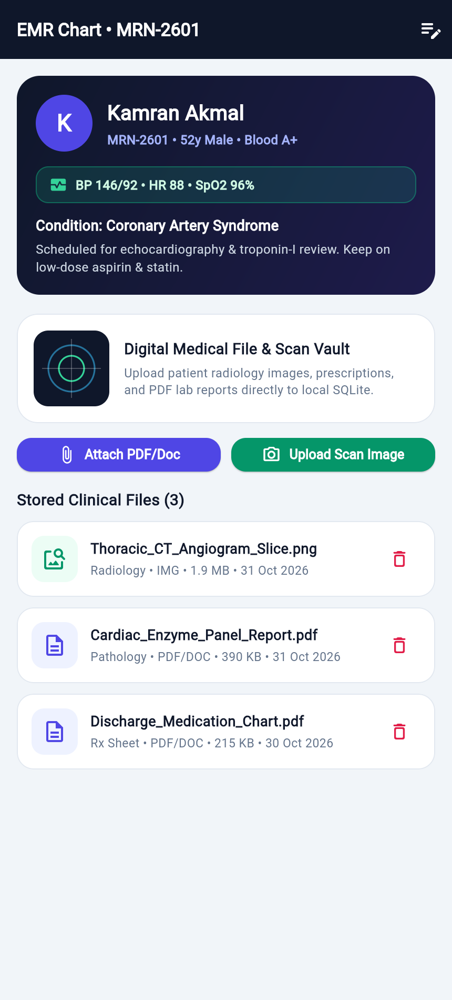
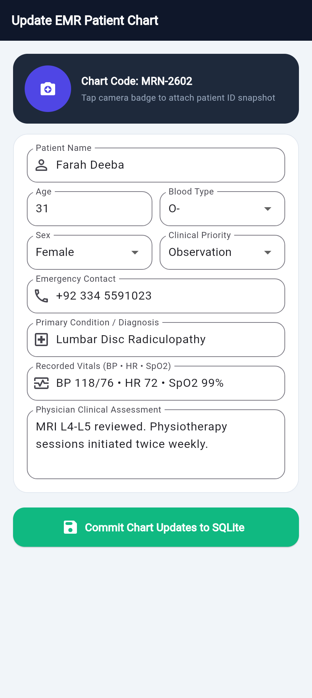
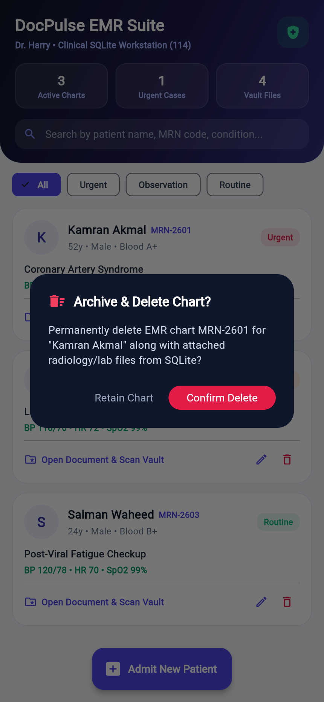

# Quiz 2: DocPulse EMR Suite — Doctor App (FA24-BCS-114)

**Submitted by:** Harry (FA24-BCS-114, Section B)

Clinical patient management app with local sqflite persistence, full CRUD patient workflows, and medical document / radiology scan attachments (ile_picker + image_picker).

## Application Screenshots

  
  &nbsp;
  
  &nbsp;
  

  
  &nbsp;
  

